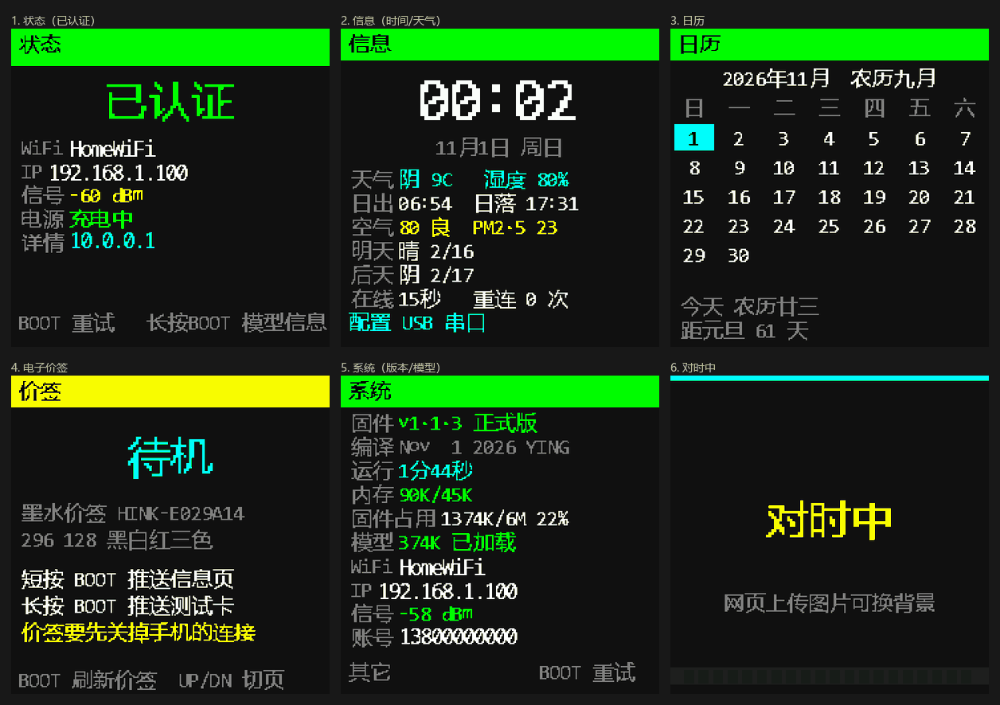
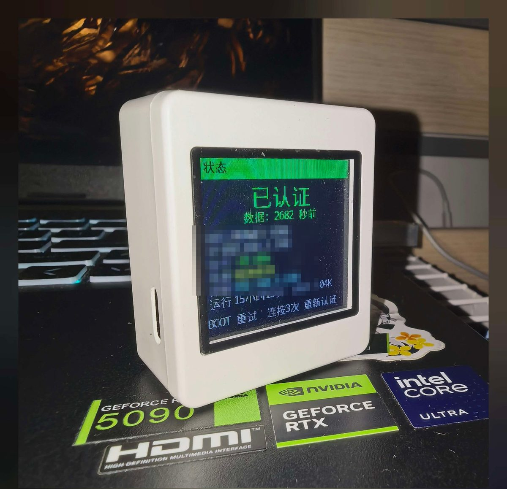
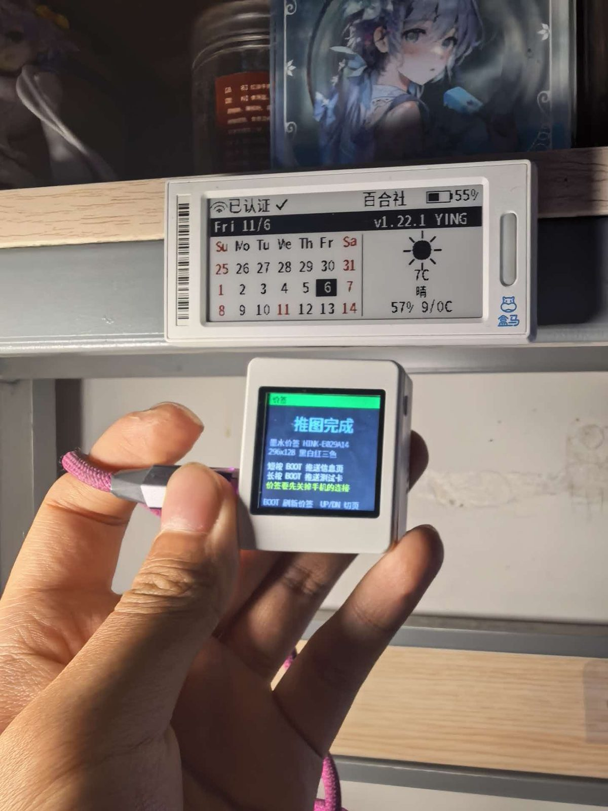
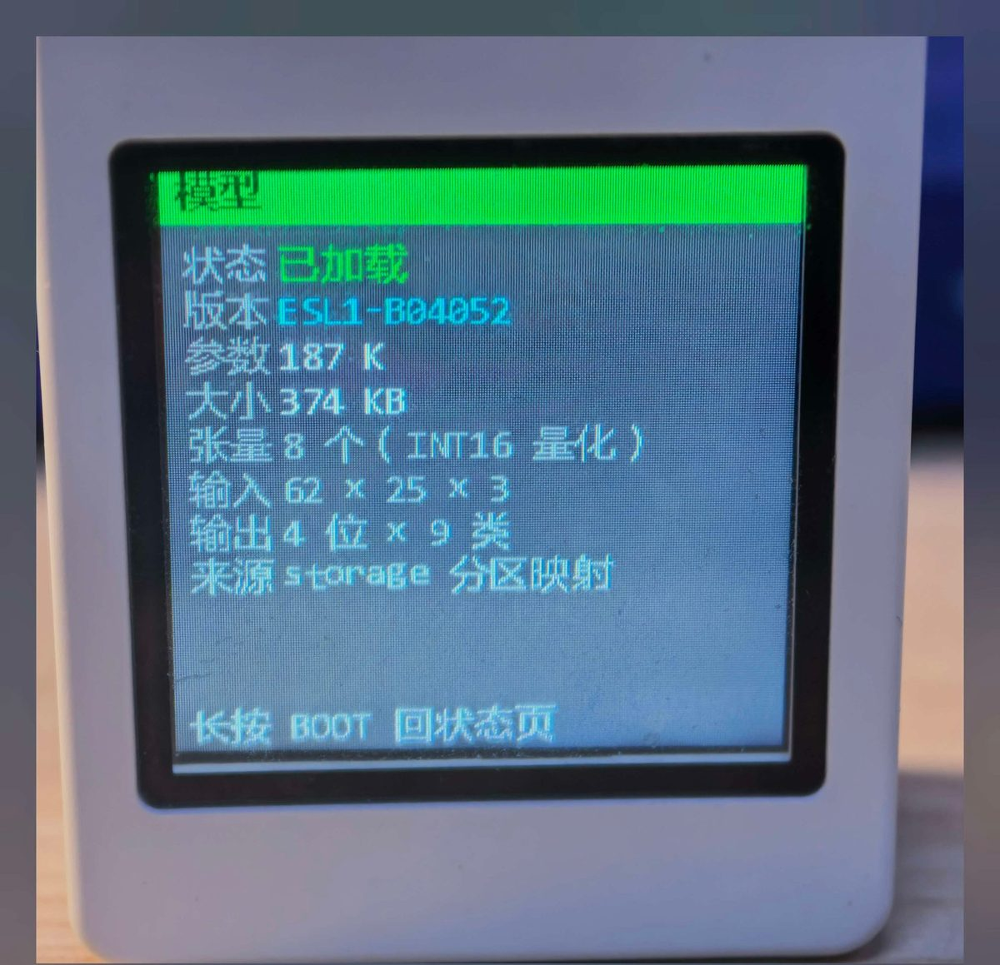
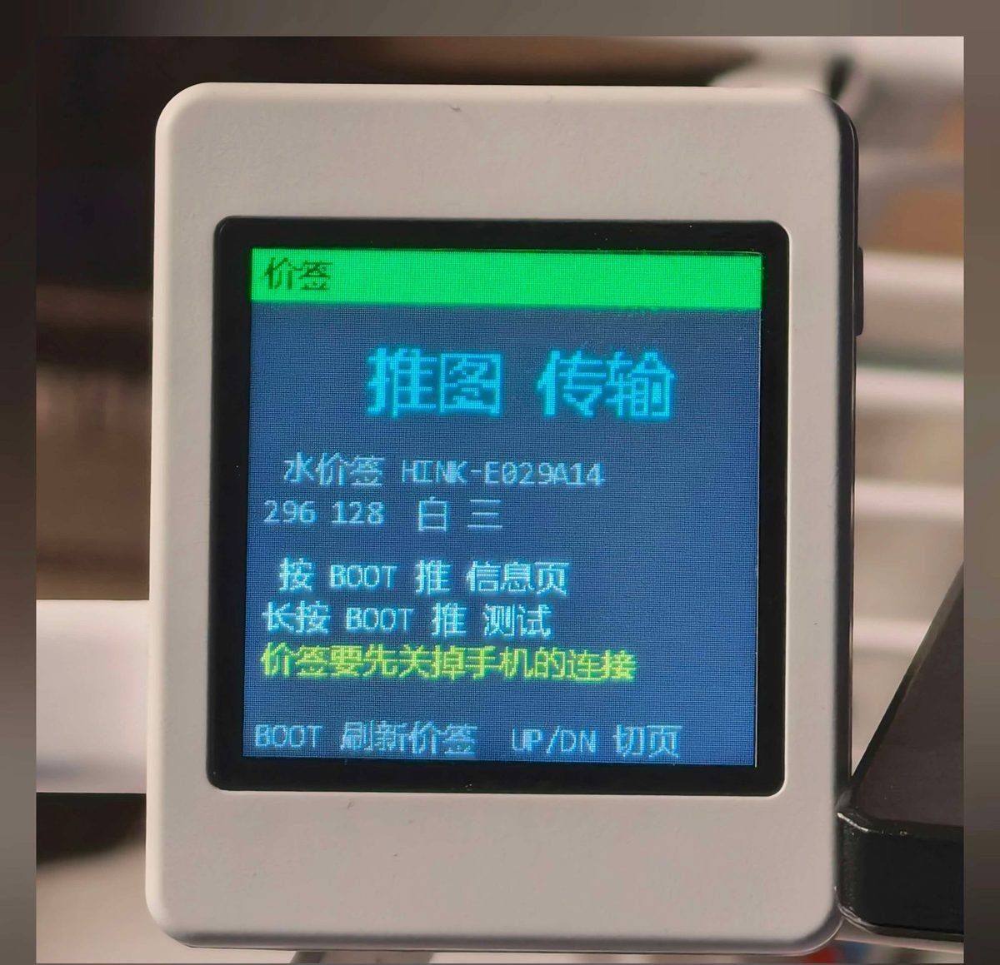
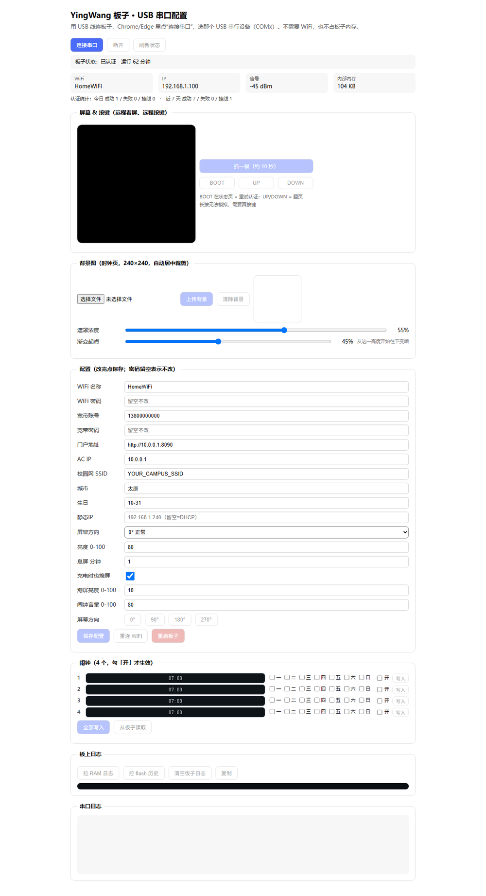

# 颖网 · 校园网门户自动认证固件（ESP32-S3）

一块 ESP32-S3 板子替你登录校园网门户：**自己识别验证码、自己提交、掉线自己重登**，
顺带当桌面时钟和三色电子价签的推送网关。整机离线运行，不需要电脑或手机。




> 板子真实截图，2× 放大。状态页和系统页的 WiFi 名 / IP / 账号已打码成占位值。
> 诊断页是板载日志滚动，截图还没导。

## 它做什么

- **自动认证**：开机连上校园 WiFi，被门户劫持就抓参数、取验证码、RSA 加密密码、提交登录；
  掉线按 30s → 30min 退避重试
- **本地验证码**：62×25 的 CNN（19 万参数）跑在片内，不联网也能认；每一位置信度低于 0.90
  就换一张图（取图不消耗登录次数）
- **电子价签**：BLE 直驱 296×128 三色墨水屏，每天推一次日期 / 日历 / 天气，含日出日落；可上传自定义图片（整屏/左半/右半）
- **网页后台**：USB 连上后浏览器里看屏幕、按键、改配置、拉日志、OTA 升级
- **屏幕界面**：状态 / 信息 / 日历 / 价签 / 系统 / 对时 / 诊断（板载日志）
- **外观自定义**：11 套配色（含 6 套二次元）+ 自定义背景/强调色，边框 · 角标图标 · 角标文字

## 真机实拍

| 整机（状态页） | 电子价签 + 手持机 |
|---|---|
|  |  |
| 3D 打印外壳，USB-C 供电兼调试口 | BLE 推完显示「推图完成」，296×128 三色屏 |

| 模型页（板载 CNN） | 价签页（按键说明） |
|---|---|
|  |  |
| 187K 参数 / 374KB / 8 个 INT16 张量 | 屏型号、按键说明、手机连接提示 |

更多见 [docs/photos/](docs/photos/)。实拍图已裁掉拍摄水印（原来带有地点和署名），
屏幕上的真实 WiFi 名、内网 IP、城市名做了马赛克。

## 网页后台

USB 连上板子，浏览器打开就是这套界面（不用装驱动、不用 WiFi）：看屏、远程按键、传背景图、
改全部配置、拉板上日志、OTA 升级。下面这张是界面本身（值都是占位符）：



省电那一段是 v1.25.0 新增的两项：**充电时也熄屏**、**熄屏亮度 0-100**
（`0` = 全黑并清屏，`>0` = 低亮度常显）。

## 快速开始

```bash
# 1. 环境：ESP-IDF v5.5.x（实测 5.5.6）
git clone -b v5.5.6 --recursive https://github.com/espressif/esp-idf.git
cd esp-idf && ./install.sh esp32s3 && . ./export.sh

# 2. 配置：复制模板，填自己的 WiFi 和宽带账号
copy main\app_config.example.h main\app_config.h    # Linux / macOS 用 cp

# 3. 编译烧录（一键脚本会顺带生成字体、烧模型）
一键编译.bat
```

不想装 IDF 的话，双击 `烧录.bat COM5` 也能把现成镜像烧进去。模型单独写 `0xC10000`：

```bash
python -m esptool --chip esp32s3 -p COM5 -b 921600 write_flash 0xC10000 model_q.bin
```

**不想装 IDF**：直接下 Release 里的整片镜像，一步烧完（占位符配置，不含真实账号）：

```bash
python -m esptool --chip esp32s3 -p COM5 -b 921600 write_flash 0x0 yingwang-v2.10.2-full.bin
```

烧完用 USB 网页后台填 WiFi / 宽带账号 / 门户地址即可，不需要联网也能填。
细节见 [docs/固件与烧录.md](docs/固件与烧录.md)。

**网页后台怎么开**：Windows 双击 `web\启动网页.cmd`（免安装），其他系统
`python web/serve.py` 后打开 `http://127.0.0.1:8765`。见 [web/README.md](web/README.md)。

> 不想 clone 整个仓库：Release 里有单独的 **`yingwang-web-tool-v2.10.2.zip`**，
> 解压后双击 `启动网页.cmd` 就能用。

门户地址、AC IP、校园网 SSID **都可以在网页后台或串口里改**（`SET portal_base=...`），
写进 NVS 掉电不丢，不用重新编译；`app_config.example.h` 里那三项只是出厂默认值。
详细步骤见 [快速上手.md](快速上手.md)。

## 已验证

不是只编译过，真机跑通了完整链路（2026-11-14，ESP32-S3 16MB/8MB PSRAM）：

- 取验证码 → 本地 CNN 识别 `8570`（置信度 0.98 / 1.00 / 0.99 / 0.98，4.4ms 推理）
- RSA 加密提交 → 门户提示「您当前登录的用户已在线」→ **自动走强制顶号** → 「本机已授权」
- 探测 `generate_204` 返回 204，判定在线，记入当日统计
- 顺便把三色电子价签推了一次：`每日刷屏结果: ESP_OK`

断电重启后从 NVS 读回配置，自动连 WiFi（WPA2，-45 dBm）→ 判定在线，不需要重新登录。

## 硬件

| 项 | 型号 |
|---|---|
| 主控 | ESP32-S3（16MB Flash / 8MB PSRAM） |
| 屏幕 | 1.54 寸 240×240 TFT（ST7789），SPI |
| 电子价签 | 盒马 HINK-E029A14-A1（296×128，黑白红三色，BLE） |
| 麦克风 | PDM 麦克风（可读环境音量；网页上的录音面板已移除，见 `docs/踩坑记录.md`） |

引脚定义在 `components/bsp_nologo/include/board_pins.h`，换板子只用改这个文件。

## 文档

| 文档 | 内容 |
|---|---|
| [快速上手.md](快速上手.md) | 三步跑起来的完整版，含常见报错 |
| [训练指南.md](训练指南.md) | 换一所学校：怎么采集、训练、量化验证码模型 |
| [docs/抓登录.md](docs/抓登录.md) | **电脑端抓登录脚本**：一条命令探出门户地址/AC/SSID，或起代理记录真登录请求（Release 里有免安装 exe） |
| [docs/固件与烧录.md](docs/固件与烧录.md) | 现成镜像 / 自己编译 / 四个分区怎么烧 |
| [docs/串口命令.md](docs/串口命令.md) | 串口 / 网页后台能发哪些命令 |
| [web/README.md](web/README.md) | USB 串口网页工具：看屏、改配置、传背景图、抓截图 |
| [docs/踩坑记录.md](docs/踩坑记录.md) | 调试时踩过的坑和真实原因 |
| [docs/学校名单.md](docs/学校名单.md) | 已验证的学校 / 运营商，以及新增一所学校的步骤 |
| [发布说明.md](发布说明.md) | 这个发布版做过哪些处理和验证 |
| [THIRD_PARTY_NOTICES.md](THIRD_PARTY_NOTICES.md) | 第三方组件与字体许可 |

## 目录

```
main/                 主循环、界面渲染
components/
  portal/             门户协议：探测、取码、RSA 登录
  captcha/            验证码模型加载与推理
  esl_ble/            电子价签 BLE 协议与画布
  net_wifi/ net_clock/ calendar/ stats/ logring/ usb_console/ ...
tools/                字体生成；captcha_train/ 是验证码采集训练工具
web/                  网页后台（USB 连上后打开）
model_q.bin           验证码模型（烧到 0xC10000）
```

## 支持学校

| 学校 | 运营商 | 状态 |
|---|---|---|
| 太原理工大学 | 中国联通 | ✅ 真机跑通（2026-11） |

完整名单、已验证的门户特征、以及「怎么加一所新学校」见 [docs/学校名单.md](docs/学校名单.md)。

## 换一所学校

第一步不是改代码，是**把门户参数抓下来**。仓库带了一个电脑端脚本，纯标准库、不依赖任何东西：

| 方式 | 怎么用 |
|---|---|
| **免安装 exe**（推荐给没装 Python 的） | 从 [Release](https://github.com/YINGBH/yingwang-esp32s3/releases/latest) 下 `capture-login.exe`，和 `抓登录.cmd` 放同一个目录，双击 `抓登录.cmd` |
| 有 Python | `python tools/capture_login.py probe` |

连上校园网（还没认证）后跑一次，它会直接打印这三行，粘进网页后台或串口就行：

```text
SET portal_base=http://10.0.0.1:8090
SET portal_ac=10.0.0.1
SET portal_ssid=校园网-SSID
```

顺手还会：判断门户是不是 `*.wlan` 那套（决定要不要改 `components/portal/`）、
抓一张验证码存到 `capture/captcha.png`（看形状要不要重训）。
不知道新门户长什么样时，用 `proxy` 模式起个本地代理，把浏览器真登录的请求记下来（密码自动打码）。
细节见 [docs/抓登录.md](docs/抓登录.md)。

参数填完再谈改代码：门户地址、AC IP、校园网 SSID 都能在网页后台改（不用编译），但**接口路径、
表单字段、RSA 公钥、判定关键字**仍按作者学校写死，换学校还得改 `components/portal/`；
验证码基本也要重训，流程见 [训练指南.md](训练指南.md)。
没有验证码的门户直接跳过识别，能省掉最麻烦的一步。

## 许可与免责

MIT，见 [LICENSE](LICENSE)。第三方署名见 [THIRD_PARTY_NOTICES.md](THIRD_PARTY_NOTICES.md)，
点阵字体用思源黑体 + Noto Sans Mono（SIL OFL-1.1）渲染，可随源码分发。

> ⚠️ 仅用于**自己账号**的自动登录。请勿用于绕过他人认证、批量蹭网、代挂账号或商业用途。
> 门户协议随时可能变更，使用风险自负。

本仓库只含板端固件：**不含** PC 端脚本 / 浏览器扩展，也**不含**任何真实账号、密码、SSID、IP、MAC。
