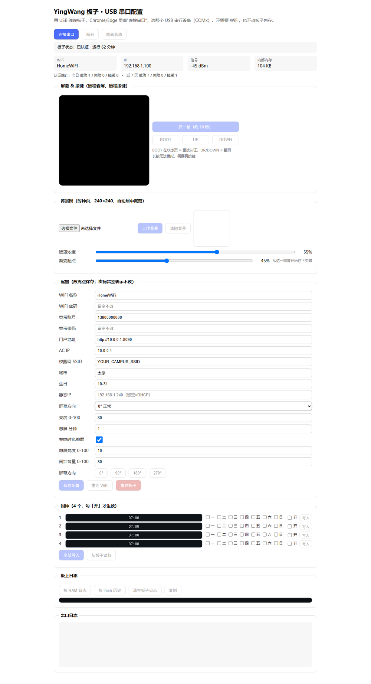

# USB 串口网页工具

浏览器直接连板子的 USB 串口，不用装任何软件就能：看屏幕、改配置、传背景图、抓截图、按按键。



> 截图里都是占位值（`HomeWiFi` / `13800000000` / `10.0.0.1`），不是某台设备的真实配置。

> 不想 clone 整个仓库？Release 里有单独的 `yingwang-web-tool-v2.12.0.zip`，
> 解压（得到下面这几个文件）后双击 `启动网页.cmd` 即可。

## 为什么需要它

Chrome/Edge 的 Web Serial API 只在**安全上下文**里可用。直接双击 `index.html`（`file://`）
时 `navigator.serial` 可能被禁用，表现为「连接串口」点了没反应。所以用本地 HTTP 起服务：

- `http://127.0.0.1:8765`（Python 版）或 `http://localhost:8767`（PowerShell 版）

## 两种启动方式

### 方式 A：Windows 免安装（推荐）

```text
双击 web\启动网页.cmd
```

它会用 PowerShell 起服务（从 8767 开始试，占用就往后挪到 8776），然后自动打开浏览器。
关闭：双击 `关闭网页.cmd`。

### 方式 B：任何装了 Python 的系统

```bash
python web/serve.py
# 然后浏览器打开 http://127.0.0.1:8765
```

## 需要什么

- **浏览器**：Chrome 或 Edge（Firefox / Safari 不支持 Web Serial）
- **线**：能传数据的 USB 线，直连电脑；别用无源 Hub（供电不稳容易掉线）
- **驱动**：Windows 10/11 自带 USB 串口驱动，不用装

## 网页能做什么

- **看状态**：WiFi / IP / 信号 / 内存 / 今日认证统计 / 模型信息
- **改配置**：WiFi 名称密码、宽带账号密码、**门户地址 / AC IP / 校园网 SSID**、城市、
  亮度、息屏时间、屏幕方向、静态 IP
- **传背景图**：任意图片自动裁成 240×240 当时钟壁纸
- **看屏幕**：抓一帧画面（约 10 秒，串口带宽 ~11.5 KB/s），远程按 BOOT / UP / DOWN
- **其他**：音量、重连 WiFi、重启、读日志

改完点保存即可，配置写进 NVS，掉电不丢。

## 常见问题

| 现象 | 处理 |
|---|---|
| 点「连接串口」一直转圈 | 换一根能传数据的线；关掉占用串口的软件（串口助手、别的标签页） |
| 浏览器里没有串口可选 | 用 Chrome/Edge；页面必须来自 `localhost` 或 https |
| 双击 .cmd 提示"Windows 已保护你的电脑" | 点「更多信息」→「仍要运行」 |
| 端口被占用 | PowerShell 版会自动往后找 8767→8776；Python 版改 `serve.py` 里的 `PORT` |
| 抓一帧很慢 | 正常，115 KB 的帧走 115200 波特率大约 10 秒 |
| 每次连串口板子都重启 | 串口工具拉 DTR/RTS 的正常行为，不是固件问题 |

## 文件

| 文件 | 作用 |
|---|---|
| `index.html` | 网页本体（HTML + CSS + JS 全在一个文件里） |
| `serve.py` | Python 本地 HTTP 服务（跨平台，端口 8765） |
| `serve.ps1` | PowerShell 本地 HTTP 服务（Windows 免安装，端口 8767+） |
| `launcher.ps1` | 起服务并打开浏览器 |
| `启动网页.cmd` / `关闭网页.cmd` | Windows 一键启停 |

> `port.txt` 是 PowerShell 版运行时写下的端口号，属于本地产物，已加入 `.gitignore`。
